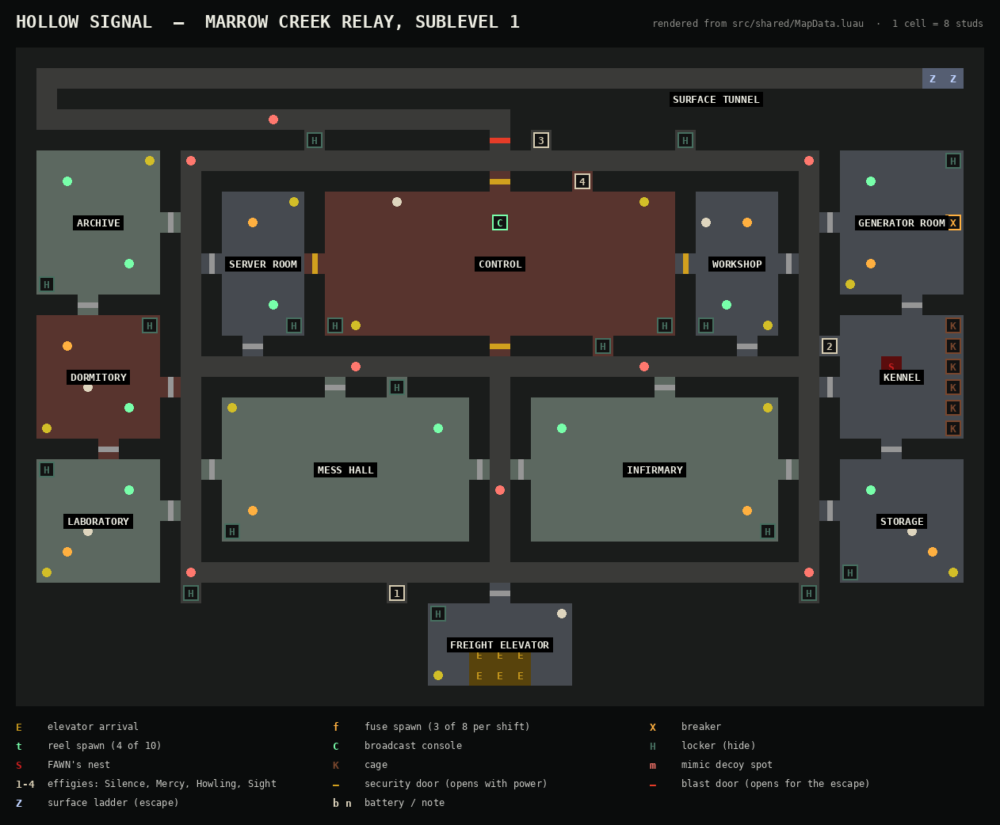

# HOLLOW SIGNAL

*It learned your voice.*

A co-op story-horror game for Roblox. A crew takes a freight elevator down into a sealed Cold-War relay station to recover four voice reels, and has to get back out past **F.A.W.N.** — a nine-foot search-and-rescue robot that wears a deer skull and stitched hides, hunts by sound, and imitates the people it has already taken.

Proprietary — see [LICENSE](LICENSE). The licence forbids use; it does not hide the code. **Keep this repository private** if the code should not be visible.

> **Status: written and statically verified, not yet play-tested.** Every file passes a strict Luau type-check against Roblox's current API definitions, and the map/pathfinding logic is unit-tested in a real Luau VM. Nothing here has been run inside Roblox Studio yet, so expect a tuning and bug-fix pass on first launch.

## The game

| Act | Goal | What changes |
| --- | --- | --- |
| Blackout | Find 3 fuses, install them at the breaker | Pitch dark. FAWN is asleep in the Kennel. |
| Tapes | Recover 4 voice reels (each plays a log) | Power wakes FAWN. It patrols, howls, and starts mimicking. |
| Broadcast | Load the reels at Control and hold the room for 80 s | The recall tone draws FAWN to you. The signal drifts and must be retuned. |
| Escape | Reach the surface ladder before lockdown | Blast door opens. FAWN is enraged and always knows where you are. |

Core rules: **noise is everything** (sprinting is heard from 85 studs, crouching from 8), closed doors block its sight, lockers hide you if it did not watch you climb in — and when it stands outside, you hold your breath. A flashlight in its eye staggers it once, then it comes for you.

What is new here:

- **Mimicry.** FAWN broadcasts lines in real crew members' names, and stands a copy of a teammate at the end of a corridor, facing away. Walk up to it and it turns its head all the way round, screams, and calls FAWN to you. It prefers to wear players it has already taken.
- **The Kennel.** Being caught is not death: you are caged. A teammate can open the gate, you get one free break-out per shift, and after that there is a rusted key on the wall.
- **Carrier signal.** The camcorder overlay fills with static and your heartbeat rises as FAWN gets closer.
- **Drop-in shifts.** One server, one sublevel: the elevator takes new crews down into a shift already in progress.

## Running it

1. Install [Rokit](https://github.com/rojo-rbx/rokit), then `rokit install` in this folder.
2. `rojo build -o HollowSignal.rbxl` and open it in Studio, or `rojo serve` and connect with the Rojo plugin.
   No Rojo? `python3 tools/build_place.py` writes `HollowSignal.rbxlx` from the same sources.
3. In Studio: **Game Settings → Security → Enable Studio Access to API Services** (for saves), and confirm **Workspace.StreamingEnabled is off** (the project file sets it; the live-sync plugin cannot).
4. Press Play. The whole world is generated from code at server start.

Recommended server size: 8.

### Audio (required for sound)

All 36 sounds were synthesized for this game by `tools/audio/synth.py` and are in `assets/audio/`. Upload them to the **JBrosDev** account (Studio → Asset Manager → Bulk Import, or the Creator Dashboard), then paste each asset id next to its name in `Config.Sounds` (`src/shared/Config.luau`). An id of `0` is simply silent, so the game runs before this is done. `assets/images/vhs_noise.png` is an optional static texture for `Config.Images.Noise`.

### Monetization setup

Create these on the Creator Dashboard and paste the ids into `Config.Products` / `Config.Passes`. Until an id is set the item is "not for sale" — and in Studio it is granted free so everything can be tested.

| Key | Type | Where the player meets it | Suggested R$ |
| --- | --- | --- | --- |
| `Revive` | Product | A rusted key inside your cage | 39 |
| `ReviveAll` | Product | Effigy of Mercy, outside the Kennel — opens every cage | 99 |
| `DeadAir` | Product | Effigy of Silence — FAWN cannot hear the crew for 60 s | 49 |
| `Sight` | Product | Effigy of Sight — objectives glow through walls | 29 |
| `ScareAll` | Product | Effigy of Howling, and the siren on the lobby porch | 25 |
| `Flashlight` | Pass | Lobby supply shelf — 2× battery, wider beam | 129 |
| `NightVision` | Pass | Supply shelf — Camcorder Night Mode (N) | 249 |
| `SecondWind` | Pass | Supply shelf — one extra free break-out per shift | 199 |
| `Tracker` | Pass | Supply shelf — HUD needle toward FAWN | 79 |
| `Stamina` | Pass | Supply shelf — 50% more stamina | 149 |
| `Veteran` | Pass | Supply shelf — gold crew tag | 99 |

How purchases are presented (deliberately, and to stay inside Roblox policy):

- They are part of the world — deer-skull effigies FAWN leaves as "trade posts", a key, a siren, a shelf — never a pop-up or a button on the HUD. The lobby shop is inside the cabin on the left wall; you spawn outside facing the elevator.
- Every purchase prompt names the item, shows the **live** Robux price, and carries a small "ROBUX PURCHASE" tag before Roblox's own confirmation dialog opens. They are subtle, not disguised: Roblox requires purchases to be transparent, and disguised prompts aimed at minors are how games get moderated.
- Nothing is sold that would do nothing (no "free everyone" when nobody is caged), and a purchase that cannot be applied the moment it lands is banked as a Rusted Key instead of being lost.
- Most products help the whole crew, which is what keeps a paid item from reading as pay-to-win in a co-op game.

### Before publishing

- Fill in the Maturity & Compliance questionnaire honestly (frequent jumpscares, no blood) — expect a **Moderate** label.
- New experiences currently start visible to 16+ only until they pass Roblox's engagement threshold.
- Set the experience's max players, icon and thumbnails.

## Controls

| Action | Keyboard | Touch / gamepad |
| --- | --- | --- |
| Sprint | Left Shift | RUN button / L3 |
| Crouch (quiet) | C or Left Ctrl | CROUCH button / R3 |
| Flashlight | F | LIGHT button / Y |
| Interact | E | Tap the prompt / X |
| Hold breath · force the bars | Space (hold) | On-screen button / A |
| Leave locker | E | GET OUT button / B |
| Night mode (pass) | N | — |

## Code map

```
src/shared     Config (all tuning, ids, fonts) · MapData (ASCII level) · Grid (A*, line of sight) · Lore · Remotes · Sfx
src/server     World/  Facility, Lobby, FawnRig, Build — everything is built from parts at runtime
               Services/  Shift (the run) · Fawn (AI) · Crew (player state) · Store (Robux) · Data (saves)
src/client     UI/  Vhs overlay, Hud, Theme     Controllers/  Atmosphere, Movement, Flashlight, FawnAnimator, Prompts
tools/         typecheck (offline Luau analysis + map tests) · audio (the synthesizer)
```



The level is the ASCII grid in `MapData.luau` — edit the characters to move rooms, doors, lockers, effigies and spawn points. FAWN navigates that grid directly, so it never depends on the navmesh.

### Checking changes without Studio

```bash
cd tools/typecheck && npm install && npm run defs && npm run check
```

```bash
node tools/typecheck/test-grid.mjs
```

## Why it is built this way

Research into what is working in Roblox horror in 2026 shaped the design: chapter-style objectives over jump-scare corridors, a sound-driven stalker, hiding with a breath mechanic, large drop-in servers, team-benefit purchases, and frequent small updates. The map format and the single `Config` file exist so that new chapters and tuning passes are cheap. The monster, story and setting are original.
