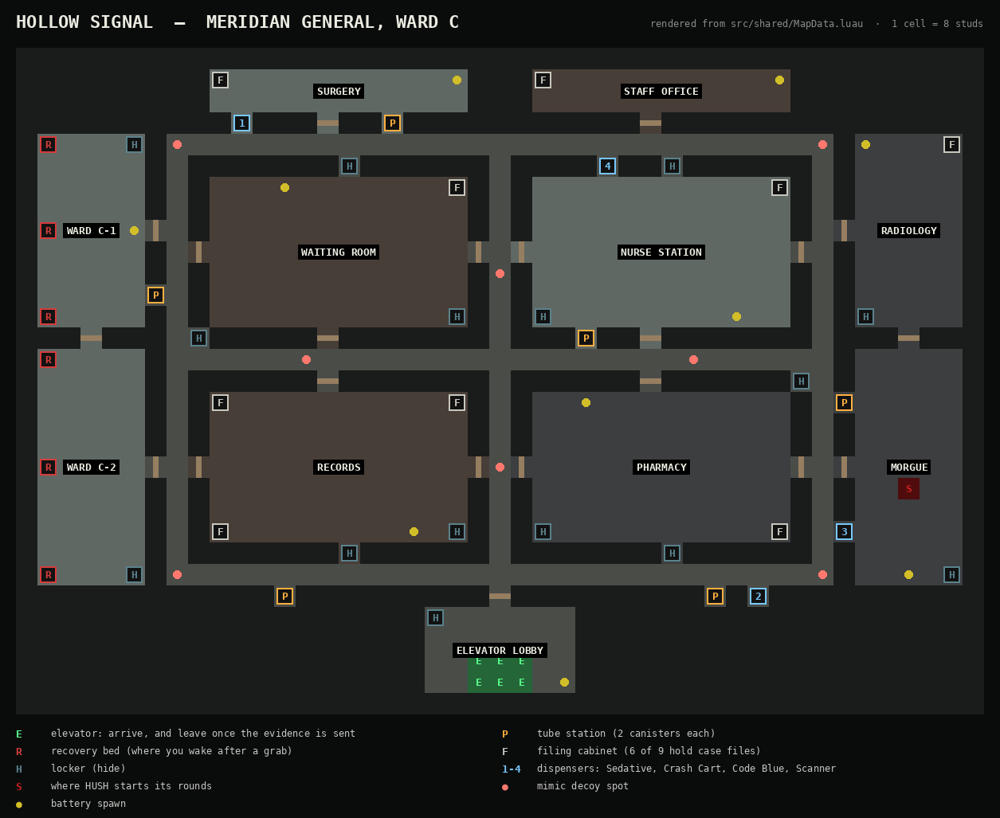

# HOLLOW SIGNAL

*Do not answer it.*

A co-op evidence-horror game for Roblox. You work for **Hollow Signal**, a company that documents things that should not exist. Tonight's case is Ward C of Meridian General, a hospital closed in 1994, where a patient-care robot called **H.U.S.H.** is still doing its rounds — wearing a hospital gown and the face of the ward's resuscitation dummy, and speaking in voices it has collected.

Proprietary — see [LICENSE](LICENSE). The licence forbids use; it does not hide the code. **Keep this repository private** if the code should not be visible.

> **Status: written and statically verified, not yet play-tested.** Every file passes a strict Luau type-check against Roblox's current API definitions, and the map and pathfinding are unit-tested in a real Luau VM. Nothing here has been run inside Roblox Studio yet, so expect a tuning and bug-fix pass on first launch.

## The job (Part 1 — The Night Ward)

1. **Photograph the subject** five times. Raise the camcorder, get HUSH in the brackets, shoot. The flash lights the whole corridor for an instant — that is how you get the picture, and how it learns where you are standing. Two photos in a row from the same spot do not count.
2. **Send the evidence.** Each photo has to leave the building through a pneumatic tube station. Stations take five seconds to load, hold two canisters each, and the whole ward hears them fire.
3. **Return to the elevator.** When the fifth canister goes, the elevator comes back, the power fails, and HUSH knows you are leaving. Lockdown is two and a half minutes away.

Rules of the ward:

- **It comes to noise.** Sprinting carries about 85 studs, crouching about 8. A meter on screen shows how loud you are.
- **It asks questions.** "Are you in pain, *YourName*?" An *Answer* prompt appears. Answering tells it exactly where you are. The briefing does tell you not to.
- **It copies people.** It calls out in crew members' names, and stands a copy of a teammate at the end of a corridor, facing away. It prefers players it has already kept.
- **A grab is not a death.** It lifts you to its face; tap to wrench free if you have a break-free left. Otherwise you lose a heart and wake up strapped to a recovery bed somewhere else on the ward. No hearts left and you are admitted.
- **Lockers** hide you if it did not watch you climb in; hold your breath when it stops outside. **Closed doors** block its sight. A **flashlight** in its lens whites it out once — then it comes for you.
- **Case files** hidden in filing cabinets tell the story and add XP to your field report.



## The lobby

Everyone loads into the hospital's old **admissions hall**: the chained entrance behind you, four lift doors at the far end, a glowing circle in front of each.

1. Step into an empty circle and the **Create Lobby** screen opens: crew size (1, 2, 3, 4 or 6), difficulty, and chapter. Part 1 is playable; Parts 2 and 3 are listed as *In development*.
2. Press **Create Lobby**. Anyone who walks into the circle joins; the sign above it shows the host and settings.
3. **Leave** is always at the bottom of the screen and puts you back outside the circle.
4. The creator can press **Start Match** at any time. When the lobby is full, a **15-second countdown** starts it automatically.

Starting a lobby sends that crew to its own private server of the same place; when the case ends everyone is returned to a public lobby. In Studio there is no teleporting, so the match starts in the same session.

Difficulty changes HUSH's speed and hearing, your hearts (4 / 3 / 2) and your break-frees (2 / 1 / 0).

## Running it

1. Install [Rokit](https://github.com/rojo-rbx/rokit), then `rokit install` in this folder.
2. `rojo build -o HollowSignal.rbxl` and open it in Studio, or `rojo serve` and connect with the Rojo plugin.
   No Rojo? `python3 tools/build_place.py` writes `HollowSignal.rbxlx` from the same sources.
3. In Studio: **Game Settings → Security → Enable Studio Access to API Services** (for saves), and confirm **Workspace.StreamingEnabled is off**.
4. Press Play. The whole world is generated from code at server start.

Recommended server size: 20–30 (it is a lobby; each crew plays on its own private server).

### Audio

All 40 sounds were synthesized for this game by `tools/audio/synth.py` and are in `assets/audio/`. Upload them to the **JBrosDev** account (Studio → Asset Manager → Bulk Import), then paste each asset id next to its name in `Config.Sounds` (`src/shared/Config.luau`). An id of `0` is silent, so the game runs before this is done. `assets/images/vhs_noise.png` is an optional static texture for `Config.Images.Noise`.

### Monetization setup

Create these on the Creator Dashboard and paste the ids into `Config.Products` / `Config.Passes`. Until an id is set the item is "not for sale" — and in Studio it is granted free so everything can be tested.

| Key | Type | Where the player meets it | Suggested R$ |
| --- | --- | --- | --- |
| `Revive` | Product | Adrenaline dispenser in the lobby — a shot kept for your next case; saves you once | 39 |
| `ReviveAll` | Product | Crash Cart dispenser by the elevator lobby — a heart back for the whole crew | 99 |
| `DeadAir` | Product | Sedative dispenser outside Surgery — HUSH cannot hear the crew for 60 s | 49 |
| `Sight` | Product | Scanner dispenser by the Nurse Station — stations and case files glow through walls | 29 |
| `ScareAll` | Product | Code Blue dispenser outside the Morgue, and the PA handset in the lobby | 25 |
| `Flashlight` | Pass | Lobby supply shelf — 2× battery, wider beam | 129 |
| `NightVision` | Pass | Supply shelf — Camcorder Night Mode (N) | 249 |
| `SecondWind` | Pass | Supply shelf — one extra break-free per case | 199 |
| `Tracker` | Pass | Supply shelf — HUD needle toward HUSH | 79 |
| `Stamina` | Pass | Supply shelf — 50% more stamina | 149 |
| `Veteran` | Pass | Supply shelf — gold name tag | 99 |

How purchases are presented:

- They are objects in the world — wall-mounted medication dispensers with a lit window, a PA handset, a shelf — never a pop-up or a HUD button. The lobby shop is on the left wall of the hall; you spawn facing the lifts, not the shop.
- Every purchase prompt names the item, shows the **live** Robux price, and carries a small "ROBUX PURCHASE" tag before Roblox's own dialog opens. Subtle, not disguised: Roblox requires purchases to be transparent.
- Nothing is sold that would do nothing right now, and a purchase that cannot be applied the moment it lands is banked as an adrenaline shot instead of being lost.
- Most products help the whole crew, which keeps a paid item from reading as pay-to-win in a co-op game.

### Before publishing

- Fill in the Maturity & Compliance questionnaire honestly (frequent jumpscares, no blood) — expect a **Moderate** label.
- New experiences currently start visible to 16+ only until they pass Roblox's engagement threshold.
- Set the experience's max players, icon and thumbnails.

## Controls

| Action | Keyboard / mouse | Touch / gamepad |
| --- | --- | --- |
| Create or join a lobby | Walk into a circle | Walk into a circle |
| Raise camcorder | Hold right mouse, or Q | CAM button / L1 |
| Photograph | Left click | PHOTOGRAPH button / R2 |
| Sprint · Crouch | Left Shift · C | RUN · CROUCH buttons |
| Flashlight | F | LIGHT button / Y |
| Interact | E | Tap the prompt / X |
| Break free | Tap E | Tap the panel |
| Hold breath (in a locker) | Hold Space | HOLD BREATH button |
| Leave locker | E | GET OUT button |
| Night mode (pass) | N | NIGHT button |

## Code map

```
src/shared     Config (all tuning, ids, fonts) · MapData (ASCII level) · Grid (A*, line of sight) · Lore · Remotes · Sfx
src/server     World/  Facility, Furnish, Lobby, FawnRig, Build — everything is built from parts at runtime
               Services/  Parties (lobby circles) · Shift (the case) · Fawn (HUSH's AI) · Crew · Store (Robux) · Data (saves, XP)
src/client     UI/  Hud, PartyUi, Vhs overlay, Theme     Controllers/  Camcorder, Flashlight, Movement, Atmosphere, FawnAnimator, Prompts
tools/         typecheck (offline Luau analysis + map tests) · audio (the synthesizer) · build_place.py · render_map.py
```

The level is the ASCII grid in `MapData.luau`; rooms are furnished automatically from their `Kind`. A new chapter is a new grid, a new `Lore` table and a new subject.

### Checking changes without Studio

```bash
cd tools/typecheck && npm install && npm run defs && npm run check
```

```bash
node tools/typecheck/test-grid.mjs
```

## A note on looks

Everything is built from Roblox parts by script, because it was written without Studio. The lighting, layout and screen design carry it — hard pools of fluorescent light, black between them, a near-monochrome grade — but it will not match a map hand-dressed with meshes and textures. Swapping the furniture builders in `World/Furnish.luau` for Creator Store models is the single biggest visual upgrade available.
